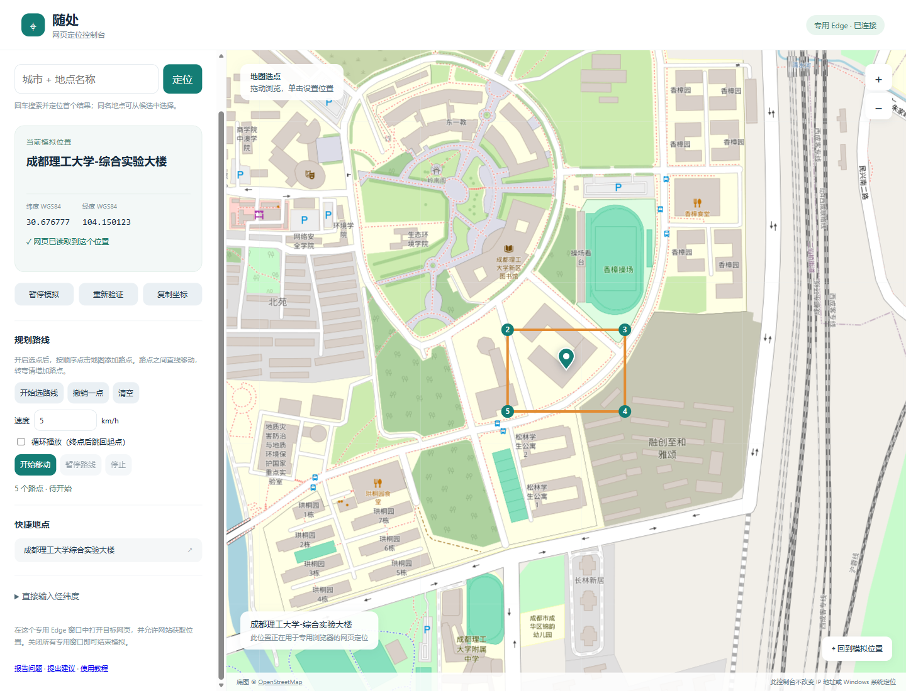
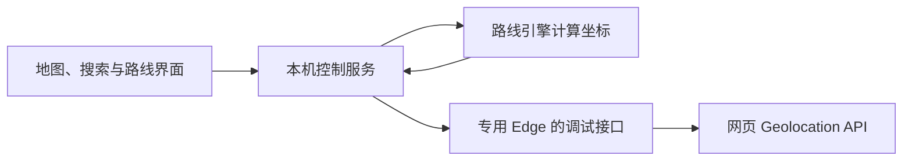

<div align="center">

# 随处 · 网页定位

在地图上选点，让网页位置沿着你画的路线移动。

[](https://github.com/zoe2026test/suichu-browser-location/actions/workflows/test.yml)


[](LICENSE)

[下载版本](https://github.com/zoe2026test/suichu-browser-location/releases/latest) · [新手教程](docs/QUICKSTART.md) · [报告 Bug](https://github.com/zoe2026test/suichu-browser-location/issues/new?template=bug_report.yml) · [提出建议](https://github.com/zoe2026test/suichu-browser-location/issues/new?template=feature_request.yml)

</div>

随处是运行在 Windows 本机的网页定位模拟工具，适合网页地图、位置服务和路线交互的开发测试。支持地点搜索、地图选点、经纬度输入及可调速的路线播放。

项目由 [zoe2026test](https://github.com/zoe2026test) 开发和维护。

> **当前下载版本是源码运行包，仍需 Node.js 和 Edge；不是 EXE 安装包，也不是在线即用网站。** 只影响工具打开的专用 Edge 中的网页，不改变手机、Windows 系统或其他应用的位置。目前不支持微信小程序定位。

## 界面预览



截图为公开示例地点和路线选点预览。

## 可以做什么

| 功能 | 操作 |
| --- | --- |
| 地点搜索 | 输入“城市 + 地点”，回车定位；同名地点可选候选结果 |
| 地图选点 | 拖动和缩放地图，单击选择位置 |
| 精确输入 | 使用 WGS84 纬度、经度设置位置 |
| 路线播放 | 依次添加路点，支持撤销和清空 |
| 速度控制 | 0.1–300 km/h，播放时可调速、暂停、继续和停止 |
| 循环播放 | 到终点后回到起点；闭合路线请把末点选回起点附近 |
| 读取验证 | 实际调用网页定位接口，查看是否读到模拟坐标 |

路点之间沿直线移动，不会自动贴合道路；转弯时请添加路点。

## 第一次使用

1. 从 **[Releases 下载运行包](https://github.com/zoe2026test/suichu-browser-location/releases/latest)**，解压到固定文件夹；开发者也可[下载最新源码](https://github.com/zoe2026test/suichu-browser-location/archive/refs/heads/main.zip)。
2. 安装 **[Node.js 22 或更新版](https://nodejs.org/en/download)** 和 **[Microsoft Edge](https://www.microsoft.com/edge/download)**。地点名称搜索还需要 **[Python 3](https://www.python.org/downloads/windows/)**，手动坐标和地图选点不依赖 Python。
3. 双击 **`启动网页定位.vbs`**。如果打不开，使用 **`start.cmd`**，在窗口中查看启动提示。
4. 在工具自动打开的专用 Edge 中设置位置，再另开标签访问待测试网页，允许网站获取位置。

**仅打开 `console.html` 或 GitHub 页面不会启用模拟。** 详细步骤、桌面快捷方式和常见问题见 **[新手教程](docs/QUICKSTART.md)**。

## 反馈与参与

- **[报告 Bug](https://github.com/zoe2026test/suichu-browser-location/issues/new?template=bug_report.yml)**：填写系统版本、操作步骤、预期与实际结果。
- **[提出建议](https://github.com/zoe2026test/suichu-browser-location/issues/new?template=feature_request.yml)**：说明使用场景和希望改善的体验。
- **[查看已有反馈](https://github.com/zoe2026test/suichu-browser-location/issues)**，提交前可以先搜索相同问题。
- 想修改代码或贡献功能？请阅读 **[贡献指南](CONTRIBUTING.md)**。

GitHub 反馈需要登录 GitHub；软件本身不要求注册账号。截图和日志请先遮住个人信息。

## 原理与项目结构



| 文件 | 作用 |
| --- | --- |
| `console.html` | 地图、路线选点、速度控制与状态显示 |
| `console-controller.cjs` | 本机接口、浏览器连接和坐标更新 |
| `route.cjs` | 距离计算、分段移动、暂停与循环 |
| `launch.cjs` / `runtime.cjs` | 启动、运行环境寻找与服务复用 |
| `search_places.py` / `geo.cjs` | 地点查询与坐标转换 |
| `route.test.cjs` | 路线引擎测试 |

默认每 500 ms 更新一次坐标，使用单调时钟计算经过的时间。控制服务绑定 `127.0.0.1`，写操作校验随机令牌与请求来源。浏览器登录状态保存在本机，不会由本工具主动上传到 GitHub。

## 开发与验证

```sh
node launch.cjs
node --test route.test.cjs
```

也可以使用 `npm start` 和 `npm test`；无需安装第三方 npm 运行依赖。

单元测试覆盖速度、暂停、途中调速、终点、循环、重复路点和无效输入。真实 Edge 测试验证过地图选点、独立页面连续读取、暂停与恢复。GitHub Actions 执行单元测试和脚本语法检查，不能代表所有第三方网站都兼容。

## 当前边界与计划

- 已实现：普通网页定位模拟和手动路线播放。
- 当前版本：Windows + Edge；源码运行包。
- 后续方向：更容易安装的桌面版本、路线保存与导入导出、更多浏览器验证。
- 尚未提供：EXE 安装包、在线账号系统、系统级定位覆盖或微信小程序适配。

电脑休眠会中断位置更新；关闭全部专用 Edge 窗口会结束本次模拟。重启不会自动播放路线。使用 IP 定位或额外校验位置的网站可能不采用模拟坐标。

**[版本记录](CHANGELOG.md)** · **[发布说明](https://github.com/zoe2026test/suichu-browser-location/releases)**

## 许可与鸣谢

项目采用 **[MIT 许可证](LICENSE)**。

- 坐标转换改编自 [hujiulong/gcoord](https://github.com/hujiulong/gcoord)，保留[原 MIT 声明](GCOORD-LICENSE.txt)。
- 地图底图来自 [OpenStreetMap](https://www.openstreetmap.org/copyright)，地图和瓦片服务不适用本项目 MIT 许可。
- 地点搜索依赖百度地图公开查询端点，服务可用性和格式可能改变；不可用时可使用坐标输入或地图选点。

GitHub **Releases** 用于发布下载版本；**Packages** 用于开发依赖包托管，本项目无需填满该栏目。
